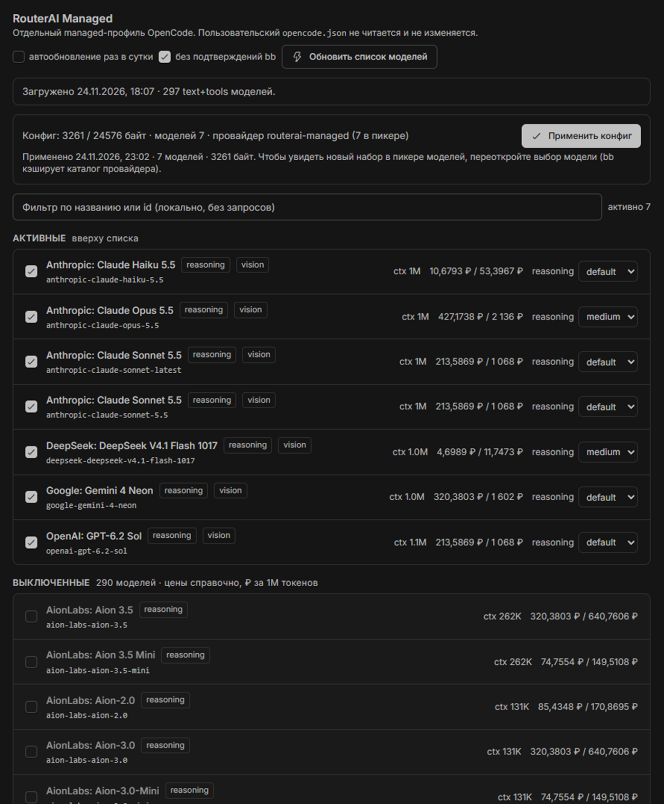

# RouterAI Managed Profile for BB

A separate OpenCode profile for [RouterAI](https://routerai.ru) models inside
[bb](https://getbb.app): a cached model catalog, model picking with reasoning
levels and prices in rubles, and a generated inline OpenCode config that bb
launches through its own ACP bridge.

Your own `~/.config/opencode/opencode.json` is never read or modified. The
plugin ships no hidden network calls: the catalog is fetched only when you ask
for it.

Русская документация: [README.md](README.md).



## What you get

- A `routerai-managed` provider in the bb model picker containing only the
  models you picked, each with context size, ruble prices and reasoning levels.
- A cached catalog on the bb server. The network is touched only by an explicit
  "Refresh models" action (`bb routerai-managed refresh`), plus an optional
  daily background refresh that is off by default.
- A sidebar page with a catalog filter, per-model toggles, a reasoning level
  selector on the right of every enabled model, and the size of the generated
  inline config.
- A `bb routerai-managed …` CLI for agents and terminals.
- Coexistence with the official `routerai` plugin: different provider id,
  different command name, different storage keys.

## Requirements

- bb `>= 0.50` with the plugin SDK `>= 0.6.157`.
- OpenCode 2.x on the machine that runs threads (`opencode` in `PATH`, or set
  `opencodeCommand`).
- A RouterAI account and API key: <https://routerai.ru>.

## Install

From the marketplace, `bb plugin install routerai-managed-profile@bb-community`,
or directly from Git:

```bash
bb plugin install git:https://github.com/vladimirovichivan/bb-routerai-models@^0.0.2
```

From a local checkout:

```bash
npm ci
bb plugin build
bb plugin install . --yes
```

Then configure:

```bash
bb plugin config routerai-managed-profile set apiKey <your RouterAI key>
bb routerai-managed refresh
bb routerai-managed enable deepseek/deepseek-v4.1-flash
bb routerai-managed apply
```

Instead of storing the key in plugin settings, you can export
`ROUTERAI_API_KEY` (or `ROUTERAI_WINDOWS_API_KEY`) for the bb server.

After `apply`, reopen the model picker: bb caches a provider's model list for
about 10 minutes.

Picker rows read `routerai-managed/<model name>`: the prefix comes from
OpenCode and the tail of a long name is truncated, so the plugin moves the
vendor to the end to keep the version visible — `Anthropic: Claude Haiku 5.5`
becomes `Claude Haiku 5.5 (Anthropic)`. The vendor is omitted when the name
already contains it (`DeepSeek: DeepSeek V4.1 Flash` → `DeepSeek V4.1 Flash`),
and alias ids (`~vendor/...-latest`) are marked `(latest)` so they cannot be
confused with the pinned release.

Reinstalling from another path keeps settings, the secret and schedules,
because bb keys them by plugin id.

## Commands

```text
bb routerai-managed refresh                 # the only catalog network call
bb routerai-managed list [--all] [--json]   # enabled models, prices, status
bb routerai-managed status [--json]
bb routerai-managed enable <model-id>
bb routerai-managed disable <model-id>
bb routerai-managed reasoning <model-id> <low|medium|high|default>
bb routerai-managed apply                   # rebuild and re-register the provider
bb routerai-managed approvals <on|off>      # bb tool approvals: on or off
bb routerai-managed show-config             # OpenCode config with a masked key
```

`--json` works on every command. `<model-id>` is the RouterAI id
(`vendor/model`), as shown by `list --all`. The command is named
`routerai-managed` because the official plugin already owns `bb routerai`.

## How it works

1. `GET https://routerai.ru/api/v1/models` with `Authorization: Bearer <key>`.
   Only models whose output is `text` and that list `tools` in
   `supported_parameters` are kept. Prices (`prompt`, `completion`,
   `input_cache_read`, `input_cache_write`) are converted from per-token rubles
   to rubles per 1M tokens; records in other units are dropped.
2. The catalog, the selection and refresh metadata live in the plugin's KV
   storage. No files are written outside it.
3. The config builder produces `OPENCODE_CONFIG_CONTENT`: `$schema`,
   `enabled_providers: ["routerai-managed"]`,
   `npm: "@ai-sdk/openai-compatible"`, `baseURL`, `apiKey`, and only the
   selected models with `limit`, `cost`, `capabilities`/`modalities` and
   `options.reasoningEffort` for an explicitly chosen level.
4. The provider is declared with `bb.providers.register` and a launch spec
   `opencode acp` plus that environment variable. bb's ACP bridge starts
   `opencode acp` on the agent host — the same mechanism the official RouterAI
   plugin uses, without depending on `provider-acp` and without writing into
   another plugin's settings.
5. `experimental_contributeEnv` hands a fresh config to every thread, including
   the model-list probe (`threadId === null`), so the picker and the agent see
   the same set while the key never lands in saved provider settings.

### Selection order and the default model

Models enter the config in the order you enabled them, so the first enabled
model stays the picker default until you disable it. Enabling an already active
model moves it to the end.

### Tool approvals

By default the provider declares bb's native dialect (`acpDialect: "opencode"`
format) and bb manages permissions through the thread mode: in `accept-edits`
it asks before every shell command, network request and write outside the
workspace. This is bb's stock behavior, so a new install starts here.

If the "Approval needed" prompts get in the way, turn on the plugin setting
**"Do not ask for tool approvals"** (`disableApprovalPrompts`):

```bash
bb routerai-managed approvals off
bb routerai-managed approvals on
```

In that mode the provider uses the generic ACP dialect (`acpDialect: "acp"`)
and the agent follows its own OpenCode permissions, like a manually registered
`opencode acp`. The plugin also passes the variables bb normally adds:
`OPENCODE_CLIENT=acp`, `OPENCODE_ENABLE_QUESTION_TOOL=false` and an
allow-all `OPENCODE_PERMISSION`. bb's thread permission switch then no longer
affects these threads. The setting applies to **new** threads; an already
running ACP session keeps the dialect it started with.

### Why modalities are mapped

RouterAI names inputs its own way: `text`, `image`, `file`, `video`, `audio`.
The OpenCode config schema accepts only `text | audio | image | video | pdf`.
A single unknown value makes OpenCode reject the **whole** config, and the
provider answers "No models are available" (`CatalogNotReady`) even if every
other model is valid. `core/config.ts` maps `file` → `pdf`, drops unknown
values, and still sets `attachment` when a model accepts files or images.

## Limits

- `OPENCODE_CONFIG_CONTENT` is a single environment variable. The Windows
  process environment block is capped at 32767 characters, so the plugin
  refuses to build a config above **24 KiB** and reports how many models to
  remove. In practice about **59 models** fit (50 models = 20649 bytes works,
  60 = 25540 bytes is refused).
- If a new selection no longer fits, the provider keeps serving the **last
  config that fit** (the picker does not go empty) while the page and `status`
  show the error.
- RouterAI does not publish an output limit; the config writes 32000 tokens,
  bounded by the model context.
- `reasoning_effort` is advertised only by some models. Levels appear only
  where the provider declares them.
- Prices are converted to rubles per 1M tokens, rounded to 4 decimals.
- Rebuilding the config makes no network calls.

## Compatibility

The official `routerai@0.2.0` plugin declares the provider `routerai` and the
command `bb routerai`; this plugin uses `routerai-managed` for both. They can
run side by side.

## Development

```bash
npm ci
npm test      # 48 tests, no network
npx tsc --noEmit
bb plugin build
bb plugin reload routerai-managed-profile
node tools/acp-probe.mjs   # what opencode acp really receives
```

Architecture, invariants, a diagnostic checklist and the roadmap live in
[AGENTS.md](AGENTS.md). Long-form store copy lives in
[PLUGIN_OVERVIEW.md](PLUGIN_OVERVIEW.md).

Tests:

- `tests/catalog.test.ts` — catalog normalization, model filter, prices,
  levels, selection order;
- `tests/config.test.ts` — `OPENCODE_CONFIG_CONTENT` shape, the 24 KiB limit,
  modalities restricted to the OpenCode enum, key redaction;
- `tests/provider.test.ts` — provider declaration and its signature;
- `tests/refresh.test.ts` — refresh error texts and cache fallback;
- `tests/sort.test.ts` — active/disabled ordering and level validation;
- `tests/user-config-unchanged.test.ts` — the user's `opencode.json` keeps its
  SHA-256 across config generation.

## License

MIT — see [LICENSE](LICENSE).
