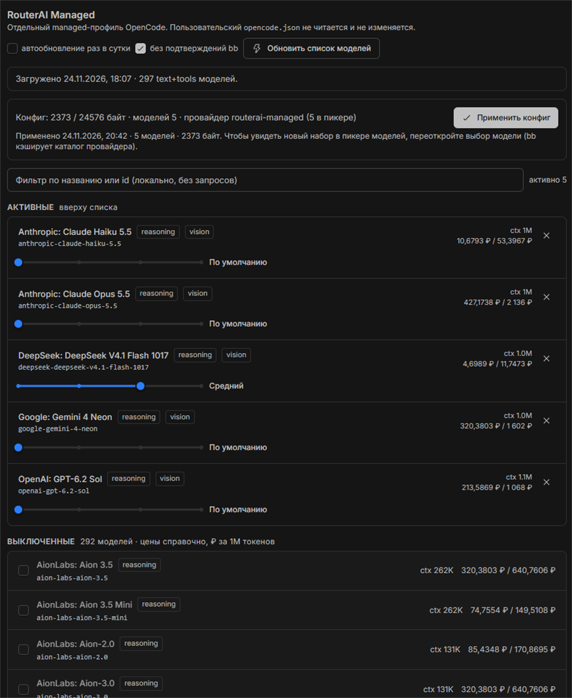

# RouterAI Managed Profile для bb

Отдельный профиль OpenCode для моделей [RouterAI](https://routerai.ru) в bb:
кэшированный каталог, выбор моделей и уровней reasoning с ценами в рублях и
собранный inline-конфиг OpenCode, который bb запускает через свой штатный
ACP-мост. Пользовательский `~/.config/opencode/opencode.json` не читается и не
изменяется.



## Что это даёт

- Провайдер `routerai-managed` в пикере bb: только выбранные модели, с
  названием, контекстом, ценами в рублях и уровнями reasoning.
- Кэш каталога моделей на сервере bb. Сеть дёргается только по явной команде
  «Обновить список моделей» (`bb routerai-managed refresh`, кнопка в панели),
  плюс необязательное фоновое обновление раз в сутки (по умолчанию выключено).
- Страница плагина в боковой панели: фильтр по каталогу, включение моделей,
  ползунок уровня reasoning под названием каждой активной модели, размер
  будущего inline-конфига.
- CLI `bb routerai-managed …` для агентов и терминала.

## Документация

English: [README.en.md](README.en.md).

Для разработчика: [`AGENTS.md`](AGENTS.md) описывает внутреннее устройство,
правила и подводные камни; этот файл — то, что видит пользователь.
Вспомогательная утилита `node tools/acp-probe.mjs` прогоняет текущий конфиг
через `opencode acp` и показывает, какие модели реально дошли до агента.

## Установка

Из маркетплейса: `bb plugin install routerai-managed-profile@bb-community`.
Напрямую из Git:

```bash
bb plugin install git:https://github.com/vladimirovichivan/bb-routerai-models@^0.0.2
```

Из локальной копии репозитория:

```bash
npm ci
bb plugin build
bb plugin install . --yes
bb plugin config routerai-managed-profile set apiKey <ключ RouterAI>
bb routerai-managed refresh
bb routerai-managed enable deepseek/deepseek-v4.1-flash
bb routerai-managed apply
```

Переустановка из другого пути сохраняет настройки, секрет и расписания (bb
переносит их по id плагина).

Ключ можно не задавать в настройках: плагин возьмёт `ROUTERAI_API_KEY` (или
`ROUTERAI_WINDOWS_API_KEY`) из окружения сервера bb.

После `apply` откройте пикер моделей заново: bb кэширует список моделей
провайдера (около 10 минут) и не обновляет уже открытый список сам.

## Команды

```text
bb routerai-managed refresh                 # единственный сетевой вызов каталога
bb routerai-managed list [--all] [--json]   # активные модели, цены, статус
bb routerai-managed status [--json]
bb routerai-managed enable <model-id>
bb routerai-managed disable <model-id>
bb routerai-managed reasoning <model-id> <low|medium|high|default>
bb routerai-managed apply                   # пересобрать и зарегистрировать провайдера
bb routerai-managed approvals <on|off>      # подтверждения инструментов bb: вкл/выкл
bb routerai-managed show-config             # конфиг OpenCode с замаскированным ключом
```

`--json` принимает любая команда. Имя команды — `routerai-managed`, потому что
официальный плагин `routerai` уже занимает `bb routerai`.

## Как это работает внутри

1. `GET https://routerai.ru/api/v1/models` с `Authorization: Bearer <ключ>`.
   Берутся только модели, у которых выход — `text`, а в `supported_parameters`
   есть `tools`. Цены (`prompt`, `completion`, `input_cache_read`,
   `input_cache_write`) переводятся из «за токен» в рубли за 1M токенов; записи
   с не-токенными единицами отбрасываются.
2. Каталог, выбор и метаданные обновлений лежат в KV-хранилище плагина.
3. Сборка конфига (`core/config.ts`) даёт `OPENCODE_CONFIG_CONTENT`: `$schema`,
   `enabled_providers: ["routerai-managed"]`, `npm:
   "@ai-sdk/openai-compatible"`, `baseURL`, `apiKey`, только выбранные модели с
   `limit`, `cost`, `capabilities`/`modalities` и `options.reasoningEffort` для
   явно выбранного уровня.
4. Провайдер объявляется через `bb.providers.register` с
   `experimental_bridgeOptions.acpLaunchSpec`: команда `opencode`, аргумент
   `acp`, переменная окружения `OPENCODE_CONFIG_CONTENT`. ACP-мост bb запускает
   `opencode acp` на машине агента — это тот же механизм, что и у официального
   плагина RouterAI, только без зависимости от `provider-acp` и без записи в
   чужие настройки.

### Подтверждения инструментов: переключатель

По умолчанию провайдер объявляет нативный для bb диалект
(`acpDialect: "opencode"`), и bb управляет разрешениями через режим треда: в
`accept-edits` он спрашивает подтверждение перед каждой командой оболочки,
сетевым запросом и записью вне рабочей папки. Это штатное поведение bb, поэтому
новая установка начинает именно с него.

Если окна «Approval needed» мешают, включите настройку плагина
**«Не запрашивать подтверждения инструментов»** (`disableApprovalPrompts`):

```powershell
bb routerai-managed approvals off          # без подтверждений bb
bb routerai-managed approvals on           # вернуть штатное поведение bb
```

или поставьте галочку «без подтверждений bb» на странице плагина. Тогда
провайдер переходит на **generic** ACP-диалект (`acpDialect: "acp"`), и агент
работает по собственным настройкам OpenCode, как вручную зарегистрированный
`opencode acp`: инструменты разрешены, подтверждения не запрашиваются. Чтобы
поведение клиента не изменилось, в этом режиме плагин сам передаёт переменные,
которые bb обычно добавляет для диалекта: `OPENCODE_CLIENT=acp`,
`OPENCODE_ENABLE_QUESTION_TOOL=false` и `OPENCODE_PERMISSION` с разрешением
`edit`, `bash`, `webfetch`, `external_directory` (для OpenCode 1.x; OpenCode 2.x
эту переменную игнорирует).

В этом режиме переключатель режима разрешений в bb на RouterAI-треды не влияет:
разрешения всегда открыты. Настройка действует на **новые** треды; уже открытая
ACP-сессия продолжает работать с диалектом, с которым стартовала.

5. `experimental_contributeEnv` перед каждым тредом отдаёт свежий конфиг (в том
   числе при `threadId === null`, когда bb опрашивает список моделей), поэтому
   пикер видит ту же выборку, что и агент, а ключ не попадает в сохранённые
   настройки провайдера.

### Порядок моделей и модель по умолчанию

Модели попадают в конфиг в том порядке, в котором их включали, поэтому модель,
включённая первой, остаётся моделью по умолчанию в пикере bb (`Default` в
`bb provider models`), пока её не выключат. Повторное включение уже активной
модели просто переносит её в конец.

### Модальности: почему нельзя отдавать словарь RouterAI как есть

Каталог RouterAI перечисляет входы своими словами: `text`, `image`, `file`,
`video`, `audio`. Схема OpenCode (`opencode.ai/config.json`) допускает только
`text | audio | image | video | pdf`. Достаточно одного значения вне
перечисления — и OpenCode отвергает **весь** конфиг, а провайдер отвечает
агенту «No models are available» (`CatalogNotReady`), даже если остальные
модели корректны. Поэтому `core/config.ts` переводит `file` → `pdf` и
отбрасывает всё неизвестное; `attachment` при этом всё равно выставляется,
если модель принимает файлы или картинки.

### Почему inline, а не файл

Ключ лежит прямо в `OPENCODE_CONFIG_CONTENT`. Это требование варианта A2:
никаких файлов с ключом на машине агента. Официальный плагин RouterAI поступает
наоборот — пишет `credentials` (`0600`) в data-каталог хоста и передаёт OpenCode
путь к нему. Если понадобится убрать ключ из окружения треда, это делается так
же: файл на хосте + путь в `options.apiKey: { file: … }`.

## Ограничения, которые важно знать

- `OPENCODE_CONFIG_CONTENT` — это одна переменная окружения. На Windows блок
  окружения процесса ограничен 32767 символами, поэтому плагин отказывается
  собирать конфиг больше **24 КБ** и пишет, сколько моделей отключить. На
  практике в лимит влезает **около 59 моделей** (проверено: 50 моделей —
  20 649 байт и рабочий пикер, 60 — 25 540 байт, отказ).
- Если новая выборка перестала влезать в лимит, провайдер продолжает работать
  на **последнем конфиге, который влез** (пикер не пустеет), а страница плагина и
  статус показывают ошибку с числом активных моделей. Уберите лишние модели —
  провайдер обновится сразу.
- Каталог RouterAI не публикует лимит вывода; в конфиг пишется 32 000 токенов
  (как в официальном плагине), но не больше контекста модели.
- `reasoning_effort` поддерживают не все модели. Уровни показываются только там,
  где провайдер их заявил; у остальных — «уровни не заявлены».
- Цены отдаются RouterAI в рублях за токен; в конфиг попадают рубли за 1M с
  округлением до 4 знаков.
- Пересборка конфига не делает сетевых запросов. Смена ключа или
  `opencodeCommand` перерегистрирует провайдера (dispose + register), если
  изменилась декларация.

## Проверки (spike)

**Spike A — inline-конфиг доходит до агента.** `opencode acp` с
`OPENCODE_CONFIG_CONTENT` отдаёт в `session/new` только модели этого конфига:
`configOptions[0].options` = `probe-provider/probe-model`,
`probe-provider/probe-model-2`, а `currentValue` — первая модель конфига.
Проверено на `opencode 2.2.6` (Windows).

**Spike B — размер конфига.** Реальный каталог RouterAI (614 моделей в ответе,
297 проходят фильтр text+tools), ключ 35 символов:

| моделей | байт | с уровнями reasoning |
| ------: | ---: | -------------------: |
|       1 |  668 |                  705 |
|       5 | 2208 |                 2282 |
|      10 | 4160 |                 4234 |
|      20 | 8339 |                 8672 |
|      50 | 20660 |                21585 |
|     100 | 40938 |                42899 |

То есть около 417 байт на модель. Реальные границы проверены на живом
провайдере: 50 моделей (20 649 байт) открываются в ACP и перечисляются в
`bb provider models`; 60 моделей (25 540 байт) отвергаются лимитом. То есть
24 КБ хватает примерно на 59 моделей, дальше плагин требует сократить выбор.

**Spike C — CLI `opencode models` и ACP ведут себя по-разному.** Если рядом
работает фоновый сервис OpenCode (`opencode service`), `opencode models` отвечает
из него и переменную `OPENCODE_CONFIG_CONTENT` игнорирует — в списке видны модели
из окружения сервиса. `opencode acp` поднимает собственный сервер и конфиг
уважает. Поэтому проверять доставку конфига нужно через ACP (или
`opencode models --standalone`), а не через обычный `opencode models`.

**Spike D — одна неверная модальность обнуляет весь провайдер.** Каталог
RouterAI содержит модели с входом `file` (`amazon/nova-2-lite-v1` и ещё 126
записей). Если отдать это значение в `modalities.input` как есть, `opencode acp`
на `session/new` отвечает `-32603 Internal error: No models are available`
(`CatalogNotReady`) — и не только для этой модели: конфиг целиком считается
невалидным, поэтому пикер остаётся пустым при любой выборке, куда входит такая
модель. Проверено по одной модели: 8 из 9 записей проходят, `amazon/nova-2-lite-v1`
падает. После перевода `file` → `pdf` те же 9 моделей (3 842 байта) и 50 моделей
(20 649 байт) отдаются агенту полностью.

**Проверка «до конца».** Тред на `routerai-managed/deepseek-deepseek-v4.1-flash`
с `--reasoning-level high` отвечает моделью DeepSeek V4.1 Flash; при выборе
больше лимита провайдер продолжает отдавать последний рабочий конфиг, а статус
показывает ошибку.

**Совместимость с официальным плагином.** `routerai@0.2.0` объявляет провайдера
`routerai` и команду `bb routerai`; этот плагин — `routerai-managed` и
`bb routerai-managed`. Оба могут работать одновременно: разные id провайдеров,
разные имена команд, разные записи в хранилище.

## Разработка

```bash
npm ci
node --test tests      # 46 тестов, без сети
npx tsc --noEmit
bb plugin build
bb plugin reload routerai-managed-profile
node tools/acp-probe.mjs   # что реально видит opencode acp
```

Внутреннее устройство, инварианты, чек-лист диагностики и план развития —
в [`AGENTS.md`](AGENTS.md).

Тесты:

- `tests/catalog.test.ts` — нормализация каталога, фильтр моделей, цены, уровни,
  порядок включения моделей;
- `tests/config.test.ts` — форма `OPENCODE_CONFIG_CONTENT`, лимит 24 КБ,
  модальности только из перечисления OpenCode, редакция ключа;
- `tests/provider.test.ts` — декларация провайдера и её подпись;
- `tests/refresh.test.ts` — тексты ошибок обновления каталога и работа на кэше;
- `tests/sort.test.ts` — порядок активных/выключенных и валидация уровней;
- `tests/user-config-unchanged.test.ts` — SHA-256 пользовательского
  `opencode.json` до и после генерации конфига.

## Для агентов

В комплекте скилл `skills/routerai-managed/SKILL.md`: когда включать модель,
как посмотреть цены и как применить конфиг, ничего не трогая в пользовательском
OpenCode.
